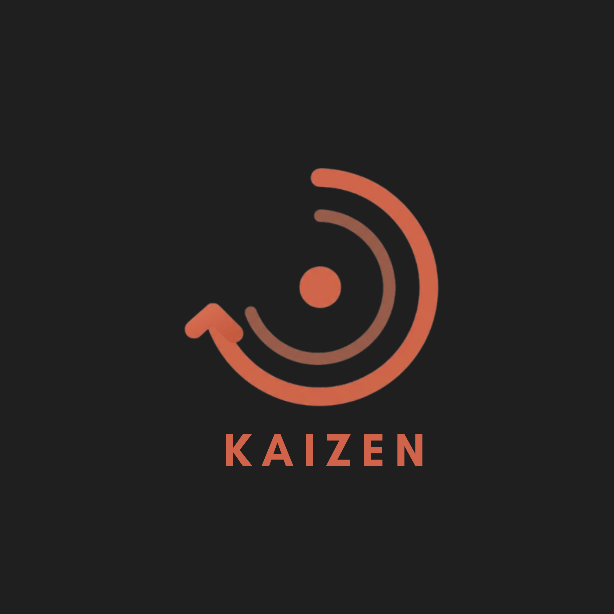

# Kaizen

**A shared product brain for teams and builders: drop in docs, links and repos, and Kaizen turns them into a living, confidence-scored knowledge base you can talk to.**

Live: https://orchestral-ai-production.up.railway.app/ · Docs: https://kaizen-docs.vercel.app



> This repo is named `Orchestral-AI` for historical reasons; the product is Kaizen, the flagship of Seemara, my one-person AI products studio.

## What it is / why I built it

Product knowledge is scattered across decks, docs, websites and people's heads. Every new hire, sales call or AI tool has to rebuild the same context from scratch, and nobody can tell which facts are current, which are guesses, and what is still missing.

I built Kaizen to fix that. It ingests a product's raw material, extracts structured facts with their sources, scores how complete and trustworthy the knowledge base is, and tells you exactly which gaps to fill. Two AI agents sit on top: a Learner that helps build the knowledge base, and an Explainer that answers questions from it. There are two workspace types:

- **Organisation**: a shared "Central Intelligence" for a team, with an org-level knowledge base inherited by every product.
- **Vibe Coder / Creator**: a personal context layer for an individual builder. Connect GitHub and Kaizen imports each repo as a project, synthesizes a creator profile, and generates a shareable portfolio.

## Features

- **Ingestion pipeline**: upload `.txt`, `.pdf` or `.docx` files or paste URLs. Text is extracted, chunked and turned into structured facts with evidence quotes and source tracking.
- **Product Knowledge Base (PKB)**: product-type-aware schema (B2B, B2C, hybrid) with per-fact lifecycle states (asserted, evidenced, inferred, disputed, stale).
- **Deterministic confidence score**: field coverage + fact quality + source diversity. No LLM is involved, so the same knowledge base always gets the same score.
- **Synthesizer**: after every knowledge-base write it regenerates the product brief, up to 3 personas, critical and standard gaps, a health narrative and suggested questions.
- **Gap filling**: a stepped dialog writes answers straight into the knowledge base, then re-synthesizes.
- **Learner agent**: a conversational knowledge-base builder with six behaviour modes based on knowledge-base stage and session context.
- **Explainer agent**: answers questions inside a product (hedges less as confidence rises), across all products on the dashboard, or as an in-app usage guide.
- **Governance**: sensitive fields (pricing, customer names, security claims, roadmap) are never auto-committed and are withheld from answers until approved. A review inbox handles conflicts, and staleness thresholds apply per field.
- **Creator mode**: GitHub import (streamed over SSE), cross-project creator profile synthesis, and public portfolio pages at `/portfolio/:orgId`.
- **Production setup**: Google OAuth login, per-org and per-product access middleware, rate limiting, an SSRF guard on URL fetches, and persisted chat history.

## Tech stack

- **Frontend**: React 18, Vite, Wouter, TanStack Query, Tailwind CSS, shadcn/ui
- **Backend**: Node.js, Express 5, TypeScript (ES modules)
- **Data**: PostgreSQL via Drizzle ORM; knowledge-base JSON and uploads stored in Supabase Storage
- **AI**: OpenAI (GPT-4o)
- **Auth**: Passport with Google OAuth 2.0
- **Deploy**: Railway (Nixpacks)

## Run locally

```bash
npm install
cp .env.example .env   # then fill in the values
npm run db:push        # push the Drizzle schema to Postgres
npm run dev            # http://localhost:5000
```

Environment variables (see `.env.example`):

- `OPENAI_API_KEY`, `DATABASE_URL`, `PORT`
- `SESSION_SECRET` (required in production), `GOOGLE_CLIENT_ID`, `GOOGLE_CLIENT_SECRET`, `APP_URL`
- `SUPABASE_URL`, `SUPABASE_SERVICE_KEY` (Storage buckets `pkb-store` and `uploads`)
- `GITHUB_TOKEN` (optional; raises GitHub API rate limits for Creator import)

Other scripts: `npm run build` (Vite + esbuild bundle), `npm start` (run the production build), `npm run check` (type-check).

## Project structure

```
client/      React frontend (pages, components, hooks)
server/      Express API
  agents/    Learner, Explainer, extractor, synthesizer, creator synthesizer
  services/  ingestion, knowledge-base storage, curator, GitHub client, portfolio generator
shared/      Drizzle schema + shared Zod types
script/      production build script
```

`CLAUDE.md` holds the detailed architecture notes. `Design prototypes/`, `Claude md evolution/`, `kaizen website/` and the standalone `.html` files are design and planning artefacts, not part of the app.

## Status

Live in production on Railway and under active development.
